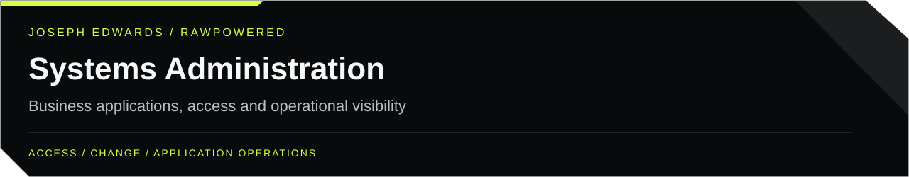
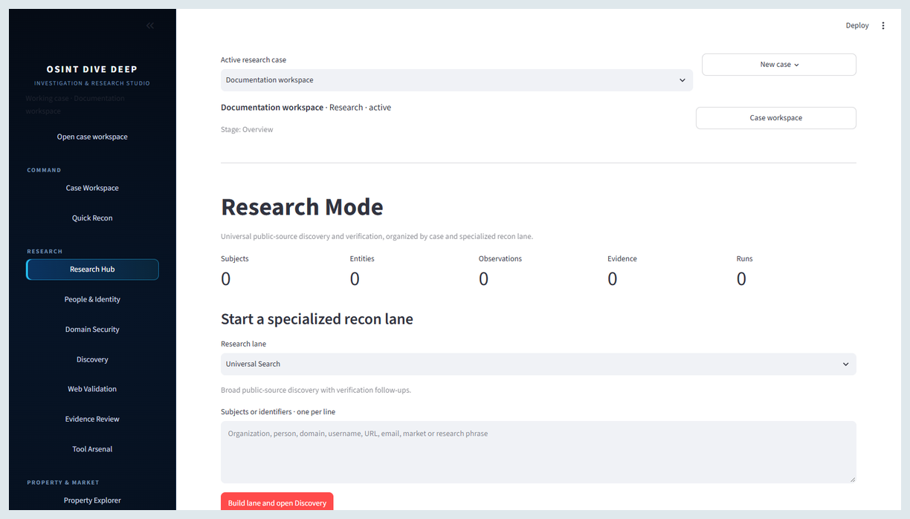
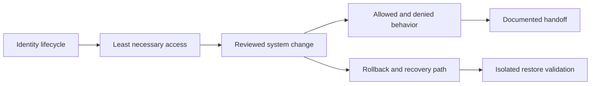

# Joseph Edwards · Systems Administration & Reliability

My administration work spans CRM and SaaS platforms, migrations, access lifecycle, field devices, and supporting software. This portfolio leads with practical ownership and documented system boundaries.

**Relevant work:** IT systems administration, business applications, SaaS operations, and automation. For SpaceX, this is a preliminary systems-administration route, pending selection of a specific vacancy.

[Profile](https://github.com/RawPowered/RawPowered) · [Detailed walkthrough](docs/WALKTHROUGH.md) · [Evidence & scope](docs/EVIDENCE.md) · [Development plan](docs/ROADMAP.md) · [LinkedIn](https://www.linkedin.com/in/josephedwardscto/)

## Start here — a three-minute review

| Evidence | What to inspect | Delivery / evidence scope |
|---|---|---|
| [Administration background](https://github.com/RawPowered/RawPowered/blob/main/docs/BACKGROUND.md) | Microsoft 365, Google Workspace, Salesforce/Zoho, user lifecycle, and Apple MDM scope. | Experience narrative; no unverified MDM vendor or current Salesforce credential asserted. |
| [Expert Solar preserved history](https://github.com/RawPowered/RawPowered/blob/main/docs/EXPERT-SOLAR.md) | Historical administration ownership, retained schema and configuration, and safe evidence handling. | Partial historical account; no automation was executed during collection. |
| [Security and privacy decisions](https://github.com/RawPowered/RawPowered/blob/main/docs/SECURITY-AND-PRIVACY.md) | Record access, credential scope, and server-side response minimization. | Specific documented/source boundaries; no general security certification. |

## A closer look

Preview from the existing public portfolio; it illustrates an interface, not a new performance result. [Unpack the decisions and operating approach](docs/WALKTHROUGH.md).

## How the work connects

Conceptual review path, not a captured execution trace. [Inspect the linked evidence and verification limits](docs/EVIDENCE.md).

## Why this path

This reference role values reliable operation, troubleshooting, documentation, automation, and infrastructure breadth. My directly supported evidence is strongest in business systems, integrations, migrations, and access administration.

Role alignment informed by the [IT Systems Administrator, Mission Systems — reference role, not a confirmed application](https://job-boards.greenhouse.io/spacex/jobs/8525777002) posting, reviewed October 25, 2026. This is an independent applicant portfolio; no employer affiliation or endorsement is implied.

## Review with me

Choose one linked case. I can walk through the problem, my responsibilities, the design or integration decision, what was checked, and what still needs acceptance. Public material respects client confidentiality; private source is not implied to be available for redistribution.

The public evidence does not yet establish the Windows/Linux server depth, enterprise network ownership, or launch/OT experience expected by some SpaceX roles. Any additional experience must be documented before adding those claims. Eligibility and role-specific requirements need separate review.

**Available for full-time and contract work.** [Connect on LinkedIn](https://www.linkedin.com/in/josephedwardscto/).
